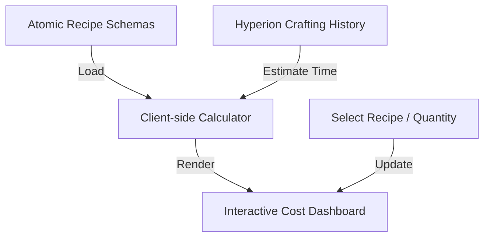

# wax-asset-crafting-cost-visualizer — Asset Crafting Cost & Time Visualizer

> **Status:** 🔒 Private (In Development) | Target Public Release: August 2026  
> **Category:** Gaming & Metagame  
> **Parent Catalog:** [pixel-journey/wax-ecosystem-blueprint-catalog](https://github.com/pixel-journey/wax-ecosystem-blueprint-catalog)

**One-sentence goal:** A visual calculator and dashboard that breaks down the on-chain resource costs, time requirements, and opportunity costs for crafting or upgrading in-game assets, helping players and designers understand the true economics of progression on WAX.

---

## 1. Overview & Goal

This blueprint makes crafting economics transparent and beautiful. Players see exactly what it costs (in resources, time, and opportunity) to create or upgrade items.

- **Why it matters for WAX:** Crafting is core to many games. Transparent cost visualization helps players plan and designers balance economies.
- **Public infrastructure only:** AtomicAssets for recipe schemas and costs, Hyperion for historical crafting data, client-side calculations. No custom contracts.
- **Target users:** Game designers, players planning progression, economy analysts, new players learning the system.
- **Success metrics:** "See full crafting cost breakdown in <3s", "Understand time vs resource tradeoffs instantly", "Make informed crafting decisions".

---

## 2. Concepts & Inspiration

- **Core concepts:** Recipes define required inputs (assets, resources) and outputs. Client aggregates costs, estimates time based on historical data or fixed timers, and visualizes total investment vs value.
- **Pain points:** Crafting costs are often hidden in text or complex trees. Players want beautiful, instant visibility into the real cost.
- **Inspirations:** Crafting trees in games (e.g. Path of Exile, Warframe), economy dashboards, modern recipe visualizers. Web3: on-chain recipe transparency + beautiful UI.
- **Cross-references:** Complements `wax-on-chain-quest-log`, `wax-player-churn-predictor`, and other gaming/metagame blueprints. Fits with analytics tools.

---

## 3. Design Specifications (Pixel Journey Standards)

### 3.1 Visual & Interaction Design
- Clean calculator interface with input selectors and instant cost breakdown.
- Main visual: Sankey or tree diagram showing resource flow into crafted item, plus time estimate.
- Sidebar: Historical success rates, average time, market value comparison.
- Micro-interactions: Smooth updates on input changes, subtle cost animations.
- Responsive: Excellent on desktop; mobile-friendly calculator view.

### 3.2 Key Views / Components
- `CraftingCalculator.tsx` — Main interactive cost visualizer.
- `ResourceFlowDiagram.tsx` — Beautiful Sankey or tree showing inputs to output.
- `TimeEstimate.tsx` — Clear time breakdown and historical averages.
- `ValueComparison.tsx` — Market value vs crafting cost analysis.
- `RecipeSelector.tsx` — Clean selector for different crafting recipes.

### 3.3 Accessibility (A11y) & Inclusive Design
- WCAG 2.2 AA: Keyboard navigation, screen reader support for costs and diagrams, high contrast.
- Alternative text-based breakdown view.
- Colorblind-safe diagrams.

### 3.4 Performance & Optimization Targets
- Instant calculations (client-side).
- Efficient diagram rendering.
- Fast recipe switching.

---

## 4. Technical Architecture

### 4.1 Core Tech Stack
- Next.js 15 + TypeScript + Tailwind + shadcn/ui + Recharts or custom SVG
- @tanstack/react-query for recipe and historical data
- AtomicAssets for recipe schemas and costs
- Simple client-side cost aggregation

### 4.2 Data Flow Diagram


### 4.3 Folder Structure
```
app/
├── (crafting)/page.tsx
├── components/
│   ├── calculator/
│   │   ├── CraftingCalculator.tsx
│   │   └── ResourceFlowDiagram.tsx
│   └── comparison/
│       └── ValueComparison.tsx
├── hooks/useCraftingCosts.ts
├── lib/wax/
│   ├── recipe-parser.ts
│   └── cost-calculator.ts
└── types/crafting.ts
```

### 4.4 Security & Privacy
- Purely public data. No PII.

---

## 5. Implementation Examples & Code Snippets

**Core crafting hook**
```ts
// hooks/useCraftingCosts.ts
export function useCraftingCosts(recipeId: string) {
  return useQuery({
    queryKey: ['crafting', recipeId],
    queryFn: async () => {
      const recipe = await fetchRecipe(recipeId);
      const history = await fetchCraftingHistory(recipeId);
      return calculateCosts(recipe, history);
    }
  });
}
```

**Cost calculation example**
```ts
function calculateCosts(recipe: any, history: any) {
  const totalCost = /* sum of input values + opportunity costs */
  const estimatedTime = /* average from history or fixed */
  return { totalCost, estimatedTime, breakdown };
}
```

---

## 6. Demo & Testing
- Demo mode with rich sample recipes and costs.
- Live mode with real project recipes.
- Interaction tests: recipe switching, quantity changes, diagram interactions.
- Calculation accuracy tests.

---

## 7. Roadmap
Phases: Recipe parsing + cost calculation engine → Dashboard UI with diagrams → Polish, a11y, value comparison → full documentation.

Future: What-if scenarios, integration with quest log, market price feeds.

---

## 8. Visual References
> Clean crafting calculators like those in Path of Exile or Warframe, but with modern Web3 polish and on-chain transparency. Elegant diagrams, clear cost breakdowns, professional yet approachable. Reference: high-quality game economy tools.

---

## 9. Related Blueprints
- `wax-on-chain-quest-log` & `wax-player-churn-predictor` — Progression and retention synergy.
- Other gaming and analytics blueprints.

---

## 10. License & Credits
MIT. Built for transparent crafting economics on WAX.

**Pixel Journey — Beautiful interfaces for public blockchain data.**
